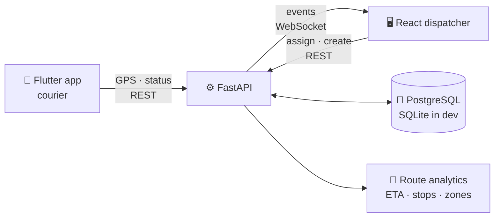

<div align="center">


<a href="https://github.com/JackSparrow322432/courier-tracker">
  
</a>

<p>
  
  
  
</p>

<p>
  
  
  
  
  
  
  
  
  
</p>

</div>

---

## 🚚 What is Courier Tracker?

**Courier Tracker** is a delivery dispatch system made of three parts that share one API:

- 📱 **Courier app (Flutter)** sends GPS position and updates order status
- 🖥 **Dispatcher panel (React + TypeScript)** shows every courier on a live map and assigns orders
- ⚙️ **Backend (FastAPI)** stores tracks, pushes events over WebSocket and analyses every route

Most courier trackers only show a dot on a map. Courier Tracker also learns from finished deliveries: it predicts how long the next one will take, flags deliveries that took far longer than expected and shows the streets where couriers lose the most time.

> 💡 Built as an individual project for the 16-week Flutter course at AlmaU (topic #30), extended with ML-based route analysis.

---

## 🧩 The problem we solve

<table>
<tr>
<td width="50%" valign="top">

### 😟 Without it
- 📞 The dispatcher calls couriers to ask where they are
- 🎲 Orders go to whoever answers first, not whoever is closest
- ⏱ Customers get a vague "about an hour"
- 🕳 Nobody knows why some deliveries take twice as long

</td>
<td width="50%" valign="top">

### ✨ With Courier Tracker
- 🗺 Every courier on one live map
- 📍 The nearest free courier suggested for every order
- 🤖 ETA from a model trained on real deliveries
- 🔍 Stops, detours and problem zones found automatically

</td>
</tr>
</table>

---

## 🎨 Features

| | Feature | What it does |
|---|---|---|
| 🗺 | **Live map** | Couriers as initials (green = free, blue = on an order), pickup **A** and drop-off **Б** points, a line from each courier to their next stop |
| 📋 | **Order queue** | Waiting / on the way / delivered; orders waiting more than 5 minutes are highlighted |
| 📍 | **Smart assignment** | The three nearest free couriers with their distance to the pickup point, assigned in one click |
| ➕ | **New order** | Fill in addresses and drop both points with two clicks on the map |
| 🧭 | **Order timeline** | Created → assigned → picked up → delivered, with timestamps |
| 🛣 | **Route breakdown** | Actual GPS track, distance travelled vs straight line, detour ratio, speed while moving, every stop |
| 📊 | **Route analytics** | Deliveries by hour, the ETA formula, a map of problem zones and a per-courier table |
| ⚡ | **Real time** | WebSocket updates without page reloads, with automatic reconnect |
| 🌗 | **Light & dark theme** | Follows the system setting, including the map |
| 🎮 | **Demo mode** | Six simulated couriers drive around Almaty, so everything works without a phone |

---

## 🤖 The Route Analysis Engine

All the ML lives in [`api/app/analytics.py`](api/app/analytics.py).

<table>
<tr><td>

🛑 **Stop detection.** Track points that stay within 40 m for over 60 seconds become a stop

↪️ **Detour ratio.** Length of the GPS track divided by the straight-line (haversine) distance

⏱ **ETA model.** Linear regression `minutes = b₀ + b₁·km + b₂·rush_hour`, retrained after every delivery; a heuristic covers the first five orders

🚨 **Anomalies.** A delivery more than 2σ slower than the model predicted gets flagged

🔥 **Problem zones.** All stops are clustered within 250 m and ranked by minutes lost

</td></tr>
</table>

**Next steps:** weather, weekday and courier load as ETA features; gradient boosting (LightGBM); OSRM map-matching to measure detours against the real shortest road path.

---

## 👥 Roles

<table>
<tr>
<td align="center" width="33%">

### 🖥 Dispatcher
Watches the live map, assigns orders, unassigns or cancels them and reviews route analytics

</td>
<td align="center" width="33%">

### 🛵 Courier
Goes online, streams GPS from the Flutter app, marks orders as picked up and delivered

</td>
<td align="center" width="33%">

### 🙋 Client
Follows their courier on the map through the same order API and WebSocket feed

</td>
</tr>
</table>

---

## 🏗 Architecture



- The server validates status transitions: `created → assigned → picked_up → delivered`, cancel from any active state; an invalid move returns `409`
- GPS points are attached to the courier's active order automatically
- One codebase runs locally on SQLite or in Docker on PostgreSQL

---

## 🛠 Tech Stack

<table>
<tr>
<td valign="top" width="33%">

### 🎨 Frontend
- ⚛️ React 19 + TypeScript
- ⚡ Vite
- 🔄 TanStack Query
- 🗺 Leaflet + React Leaflet
- 🗾 OpenStreetMap tiles
- 🔌 Native WebSocket

</td>
<td valign="top" width="33%">

### ⚙️ Backend
- 🐍 Python 3.12
- 🚀 FastAPI + Uvicorn
- 🗄 SQLAlchemy 2
- ✅ Pydantic 2
- 🔢 NumPy (regression)
- 📡 WebSocket hub

</td>
<td valign="top" width="33%">

### 📱 Mobile & Infra
- 💙 Flutter (courier app)
- 📍 geolocator · dio
- 🐳 Docker Compose
- 🐘 PostgreSQL 16
- ⚖️ nginx

</td>
</tr>
</table>

---

## 📁 Project Structure

```
.
├── ⚙️ api/
│   └── app/
│       ├── main.py            # REST routes + WebSocket
│       ├── services.py        # Business logic, assignment, ETA
│       ├── analytics.py       # Stops, detours, regression, zones
│       ├── simulator.py       # Demo couriers in Almaty
│       ├── models.py          # SQLAlchemy models
│       ├── schemas.py         # Pydantic schemas (the API contract)
│       └── ws.py              # Event broadcasting
├── 🎨 web/
│   └── src/
│       ├── components/        # Map, queue, order card, analytics
│       ├── api.ts             # Typed API client
│       └── useLive.ts         # WebSocket → query cache
├── 📱 mobile/                 # Flutter courier app
└── 🐳 docker-compose.yml      # PostgreSQL + API + web
```

---

## 🚀 Quick Start

**Requirements:** Python 3.11+, Node.js 20.19+ or 22.12+

**1. Backend**

```bash
cd api
python -m venv .venv
source .venv/bin/activate        # Windows: .\.venv\Scripts\Activate.ps1
pip install -r requirements.txt
python -m uvicorn app.main:app --reload    # → http://localhost:8000/docs
```

**2. Frontend**

```bash
cd web
npm install
npm run dev                      # → http://localhost:5173
```

**Or everything at once with Docker:**

```bash
docker compose up --build        # web → :8080, API → :8000
```

<details>
<summary>🔧 Environment variables</summary>

| Variable | Default | Purpose |
|---|---|---|
| `DATABASE_URL` | `sqlite:///./courier.db` | Database connection string |
| `SIMULATE` | `1` | `0` turns off the demo couriers |
| `CORS_ORIGINS` | `*` | Allowed origins for the API |
| `VITE_API_URL` | *(empty)* | API address for the web build; empty uses the dev proxy |

</details>

---

## 📡 API Overview

Full interactive docs at `/docs` (Swagger). Courier endpoints are tagged `mobile`.

| Domain | Method & Path |
|---|---|
| 🛵 Register a courier | `POST /api/couriers` |
| 🟢 Go online / offline | `POST /api/couriers/{id}/online?online=true` |
| 📍 Send GPS position | `POST /api/couriers/{id}/location` |
| 📦 Courier's active orders | `GET /api/couriers/{id}/orders` |
| 📋 List / create orders | `GET` · `POST /api/orders` |
| 🎯 Nearest free couriers | `GET /api/orders/{id}/suggest` |
| ✅ Assign | `POST /api/orders/{id}/assign` |
| 🔄 Change status | `PATCH /api/orders/{id}/status` |
| 🛣 Track & route breakdown | `GET /api/orders/{id}/track` · `/analysis` |
| 📊 Analytics summary | `GET /api/analytics/summary` |
| ⚡ Live events | `WS /ws` |
| 💚 Health check | `GET /api/health` |

<details>
<summary>📱 Flutter: sending GPS</summary>

```dart
final dio = Dio(BaseOptions(baseUrl: 'http://10.0.2.2:8000')); // localhost from the Android emulator

StreamSubscription<Position> startTracking(int courierId) {
  return Geolocator.getPositionStream(
    locationSettings: const LocationSettings(
      accuracy: LocationAccuracy.high,
      distanceFilter: 15,
    ),
  ).listen((p) {
    dio.post('/api/couriers/$courierId/location', data: {
      'lat': p.latitude,
      'lng': p.longitude,
      'speed': p.speed < 0 ? null : p.speed, // m/s
    });
  });
}

Future<void> markDelivered(int orderId) =>
    dio.patch('/api/orders/$orderId/status', data: {'status': 'delivered'});
```

</details>

---

## 🗺 Roadmap

- [x] Dispatcher panel with live map
- [x] REST + WebSocket API
- [x] ML route analysis and ETA model
- [x] Demo simulator
- [ ] Flutter courier and client app
- [ ] JWT authentication with dispatcher / courier / client roles
- [ ] Alembic migrations
- [ ] Dart API client generated from OpenAPI

---

## 💚 Author

<div align="center">

**Amanali Karatay**, Full-stack & ML developer · Almaty, Kazakhstan 🇰🇿

<a href="https://github.com/JackSparrow322432"></a>
<a href="https://www.linkedin.com/in/amanali-karatay-536b712a1/"></a>

</div>


